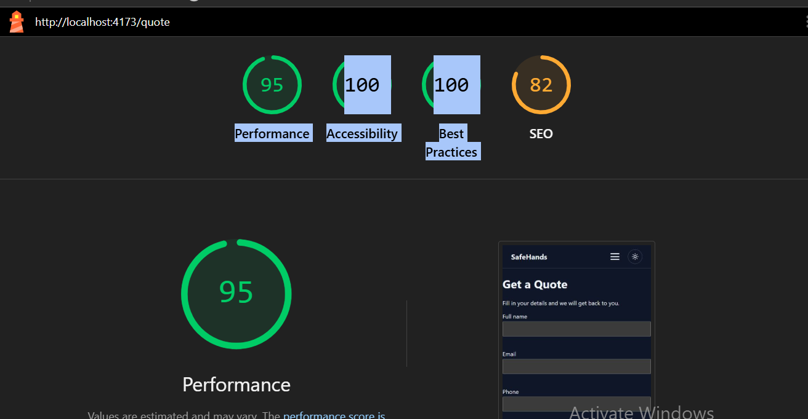

# SafeHands Insurance Quote SPA

[](https://github.com/taimurniazi2498/safehands-deploy/actions/workflows/ci.yml)

**Live site:** https://safehands-insurance-quote.netlify.app

## Project

A single-page app for SafeHands Insurance Brokers where a visitor can request an insurance quote online. Built with React and Vite.

- Pages: Home, About and Quote, with React Router and a responsive NavBar (hamburger menu below 768px)
- Accessible quote form: full name, email, phone and insurance type, with live validation, ARIA error messages and focus on the first invalid field
- Mock quotes API (jsonplaceholder) with a loading spinner, a friendly error message with a "Try again" button, and a quote card on success
- Light and dark theme with a sun/moon toggle, saved in `localStorage`
- Route-based code splitting with `React.lazy` for the About and Quote pages
- Lighthouse on the production build: 100 for Performance, Accessibility and Best Practices



**Tech:** React, Vite, React Router, validator.js, CSS Modules, Vitest, React Testing Library, Cypress, GitHub Actions, Netlify

**Structure**

- `src/components/`: NavBar, QuoteForm, QuoteResult, Spinner, ErrorBanner
- `src/pages/`: Home, About and Quote pages
- `src/context/`: theme provider and `useTheme` hook
- `src/hooks/useQuoteRequest.js`: request state (idle, pending, success, error), retry and cancel
- `src/api/quotesApi.js`: the call to the mock endpoint
- `cypress/e2e/`: end-to-end tests
- `.github/workflows/ci.yml`: CI/CD pipeline
- `netlify.toml`: build settings and the redirect for client-side routes

## Setup

You need Node.js 20 or newer (CI uses Node 22) and npm.

```bash
git clone https://github.com/taimurniazi2498/safehands-deploy.git
cd safehands-deploy
npm install
npm run dev
```

Open http://localhost:5173.

| Command | What it does |
| --- | --- |
| `npm run dev` | Start the dev server |
| `npm run build` | Production build into `dist/` |
| `npm run preview` | Serve the production build locally |
| `npm run lint` | Run ESLint |
| `npm test` | Run unit tests once |
| `npm run coverage` | Run unit tests with a coverage report |
| `npm run cypress:run` | Run the Cypress tests (start `npm run dev` first) |
| `npm run cypress:open` | Open the Cypress runner |

## Testing

- **Unit tests (Vitest + React Testing Library):** `npm test`. 34 tests cover the NavBar, routing, the form validation, the quote result, spinner, error banner, the `useQuoteRequest` hook and the API (with `fetch` mocked). Coverage: 97.8% statements, 87.3% branches, 100% functions, 98.2% lines (`npm run coverage`).
- **End-to-end tests (Cypress):** `npm run cypress:run` with `npm run dev` running. The quotes API is intercepted, so the tests do not need the network. They check validation errors, a successful quote, an error followed by retry, and that the dark theme survives a reload.
- **Lint:** `npm run lint`.
- **Manual check of loading and error states:** submit the form, then set Chrome DevTools, Network, throttling to Offline and submit again to see the error message. Set it back to No throttling and press "Try again".

## Deployment

Every push to `main` runs `.github/workflows/ci.yml`:

1. **test** job: install, lint, unit tests with coverage, production build and Cypress tests.
2. **deploy** job: runs only if `test` passes and only on a push to `main`. It builds the app and publishes `dist/` to Netlify with the Netlify CLI.

The workflow status is shown by the CI badge at the top of this file.

**GitHub secrets needed** (Settings, Secrets and variables, Actions):

- `NETLIFY_AUTH_TOKEN`: a Netlify personal access token
- `NETLIFY_SITE_ID`: the Project ID of the Netlify site (Project configuration, General)

`netlify.toml` sets the build command (`npm run build`), the publish folder (`dist`) and a redirect of all paths to `index.html`, so `/about` and `/quote` still work after a page refresh.

**Manual deploy (if ever needed):** install the Netlify CLI, then run `npm run build` and `netlify deploy --prod --dir=dist`.

## Client Handover

**Live URL:** https://safehands-insurance-quote.netlify.app

**What the client gets:** a working quote request site with Home, About and Quote pages, a light/dark theme, and automatic publishing: every change merged to `main` goes live after the checks pass.

**Using the site:** open the Quote page, fill in name, email, phone and insurance type, and press "Get my quote". Errors are shown under each field. If the request fails, a "Try again" button appears.

**Things to know**

- The quotes API is a mock (jsonplaceholder). The premium and coverage amounts on the quote card are calculated in the front end from a simple demo formula in `src/components/QuoteResult.jsx`. For real quotes, replace the endpoint in `src/api/quotesApi.js` with the real service and take the amounts from its response.
- Submitted form data is not stored anywhere in this version.
- The chosen theme is stored in the visitor's browser (`localStorage` key `theme`).

**Maintenance tips**

- Before changing anything, run `npm run lint`, `npm test` and `npm run build`. The same checks run in CI, and a failing check stops the deploy.
- Check for outdated packages from time to time with `npm outdated`, and update them in a separate commit so problems are easy to find.
- If the Netlify token expires, create a new one in Netlify (User settings, Applications) and replace the `NETLIFY_AUTH_TOKEN` secret in GitHub.
- To go back to an earlier version of the site, open Netlify, Deploys, choose an older deploy and press "Publish deploy".
- To use a custom domain, add it in Netlify under Domain management.
